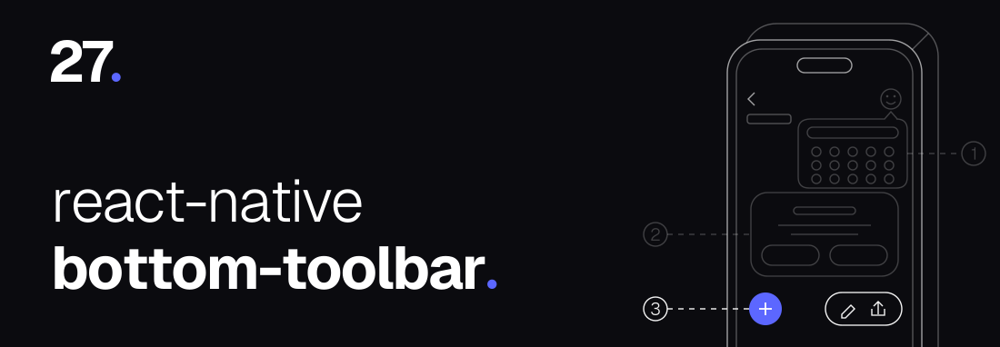
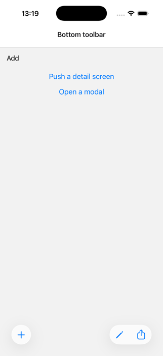
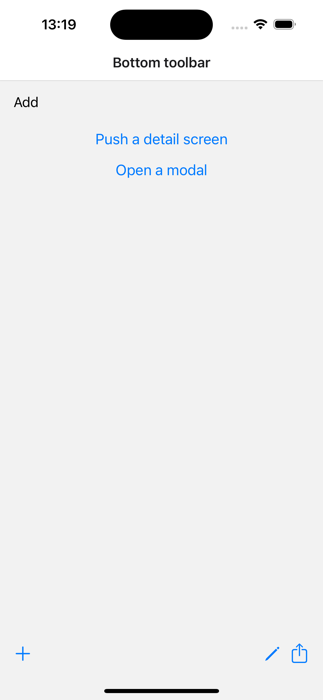
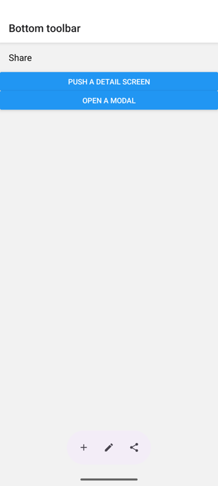
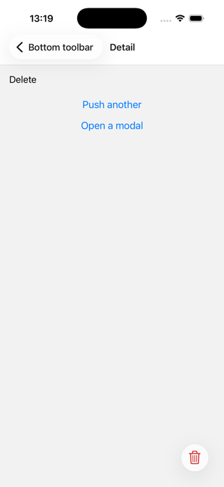
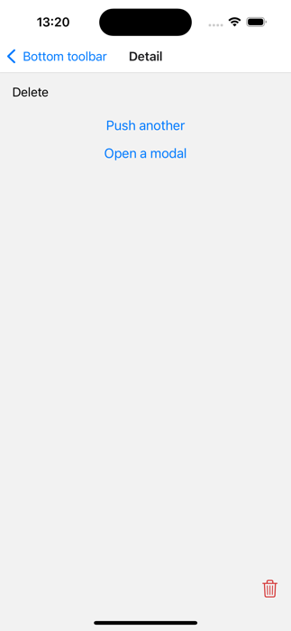
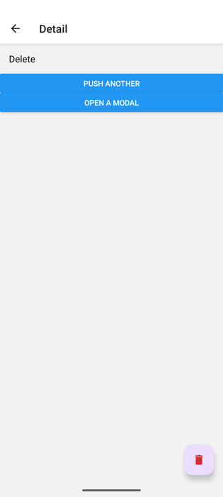

<h1></h1>

<p>
  <a href="https://www.npmjs.com/package/@27appstudio/react-native-bottom-toolbar"></a>
  <a href="https://github.com/27AppStudio/react-native-bottom-toolbar/actions/workflows/ci.yml"></a>
  <a href="#installation"></a>
  <a href="LICENSE"></a>
</p>

The platform's own bottom toolbar for React Native screens, drawn by UIKit and Material 3 rather than redrawn in JS:

- **iOS**: UIKit's navigation-controller toolbar, so you get what the system draws. On iOS 26 that's Liquid Glass (a lone item becomes a glass circle, like the bin in Photos), and earlier versions get the classic toolbar. Your app follows each iOS redesign without changes.
- **Android**: Material 3 components. One button shows as a FAB; two or more show as the M3 Expressive floating toolbar. Both sit above the navigation bar.

|                           | iOS 26                                                                                                                                                        | iOS 18                                                                                                                                     | Android                                                                                                                        |
| ------------------------- | ------------------------------------------------------------------------------------------------------------------------------------------------------------- | ------------------------------------------------------------------------------------------------------------------------------------------ | ------------------------------------------------------------------------------------------------------------------------------ |
| Several items             |  |  |  |
| One item, red `tintColor` |                                                                 |                            |                      |

It's a TurboModule with no views of its own in JS, no Expo modules, and no config plugin.

Used in production in [Splitify](https://splitify.cc).

## When to use something else

- **Expo Router**: use [`Stack.Toolbar`](https://docs.expo.dev/router/advanced/stack-toolbar/), which does the iOS side natively.
- **react-native-screens v5**: a per-screen `ios.toolbarItems` option is proposed in [#4690](https://github.com/software-mansion/react-native-screens/pull/4690). Once it ships in a stable release, prefer it for iOS.

This library fills the gap for React Navigation's `native-stack` on react-native-screens v4, and is the only one of the three with an Android side.

## Installation

```sh
npm install @27appstudio/react-native-bottom-toolbar
cd ios && pod install
```

Requirements:

- React Native 0.82+ with the New Architecture
- **iOS**: the screen must be in a native stack (`@react-navigation/native-stack` or another UINavigationController); the JS stack has none.
- **Android**: nothing more. The library ships `com.google.android.material:material` 1.13. Material 3 apps use their own theme colors; AppCompat apps get the default Material 3 DayNight palette.
- **Expo**: works in development builds, not in Expo Go.

## Usage

### With React Navigation

```tsx
import { useBottomToolbar } from '@27appstudio/react-native-bottom-toolbar/react-navigation';

function ExpenseScreen({
  navigation,
}: NativeStackScreenProps<Params, 'Expense'>) {
  useBottomToolbar(navigation, [
    {
      id: 'delete',
      systemImage: 'trash', // SF Symbol (iOS)
      androidIcon: 'ic_delete', // drawable resource (Android)
      accessibilityLabel: 'Delete',
      onPress: confirmDelete,
    },
  ]);
  // ...
}
```

The hook shows the toolbar once the push has landed (or right away on the stack's first screen), hides it when the screen loses focus, and brings it back when a modal over the screen closes. New `items` or `options` update a toolbar already on screen, and an empty array hides it, so memoize them (`useMemo`) rather than building a new array on every render.

### Without React Navigation

```ts
import { show, hide } from '@27appstudio/react-native-bottom-toolbar';

show(
  [
    { id: 'add', systemImage: 'plus', androidIcon: 'ic_add', onPress: add },
    { type: 'flexibleSpace' },
    {
      id: 'share',
      systemImage: 'square.and.arrow.up',
      androidIcon: 'ic_share',
      onPress: share,
    },
  ],
  { tintColor: '#0A7D6E' }
);

hide();
```

On iOS, `show` targets the visible navigation controller's top screen, and waits for a running push or pop to finish first.

## API

### `show(items, options?)`

Replaces the items of any toolbar already shown.

| Item                             | Fields                                                                                                                                                                                |
| -------------------------------- | ------------------------------------------------------------------------------------------------------------------------------------------------------------------------------------- |
| Button (default)                 | `id` (required), `onPress`, `systemImage` (iOS SF Symbol), `androidIcon` (drawable name), `title` (used when there's no icon), `accessibilityLabel` (defaults to `title`), `disabled` |
| `{ type: 'flexibleSpace' }`      | iOS: pushes the items apart. Android: ignored.                                                                                                                                        |
| `{ type: 'fixedSpace', width? }` | iOS: a fixed gap; on iOS 26 it also splits glass groups. Android: ignored.                                                                                                            |

When `items` contains no space, iOS puts the buttons at the trailing edge. When it contains no button at all (`[]` or spacers only), `show` hides the toolbar, as `hide()` does, so a screen can pass an empty array while it has nothing to offer.

`options.tintColor` sets the icon and title color. iOS defaults to the navigation bar's tint (matching the header buttons); Android defaults to the Material 3 theme.

### `getHeight(): Promise<number>` and `useBottomToolbarHeight(): number`

The room the toolbar takes at the bottom, in points, to keep a list's last row clear of it (its touches take the whole band, not just the buttons):

- iOS: the band the bar adds over the content above the bottom safe area, measured from the screen's safe area (iOS 26 floats the bar inside a full-screen frame, so the bar's own frame says nothing). 0 where the bar doesn't sit under the content, such as a foldable's side column. While hidden, the band last measured, else the bar's own height.
- Android: the floating button or toolbar's height plus its margin, above the navigation bar.

`useBottomToolbarHeight()` keeps it up to date: it measures again once a `show` has settled and when the window changes size (rotation, a foldable opening). It reads 0 until the first answer.

```tsx
const toolbarHeight = useBottomToolbarHeight();
// ...
<FlatList ListFooterComponent={<View style={{ height: toolbarHeight }} />} />;
```

### `hide()`

### `addPressListener(listener: (id: string) => void): () => void`

Called for every button tap, in addition to that button's own `onPress`.

### `isAvailable: boolean`

`false` where the native module is missing (web, Expo Go). There, `show` and `hide` do nothing.

### `useBottomToolbar(navigation, items, options?)`

Imported from `/react-navigation`. New `items` or `options` update the toolbar while the screen is on top (an empty array hides it); they never resubscribe the navigation listeners. Memoize them, or every render sends them to the native side again.

## Platform notes

- **iOS content insets**: UIKit adds the toolbar to the screen's safe area, so a `ScrollView` with `contentInsetAdjustmentBehavior="automatic"` scrolls clear of it.
- **Android content insets**: the FAB and toolbar float over your content. Leave about 88dp of bottom padding in scrolling content so the last row isn't covered.
- **Android icons**: add vector drawables to `android/app/src/main/res/drawable`. A button without a drawable shows its `title` as text in the toolbar; a FAB needs an icon.

## Contributing

- [Development workflow](CONTRIBUTING.md#development-workflow)
- [Sending a pull request](CONTRIBUTING.md#sending-a-pull-request)
- [Code of conduct](CODE_OF_CONDUCT.md)

## License

MIT

## react-native-bottom-toolbar is made by 27AppStudio

[27AppStudio](https://27appstudio.com) is an independent French mobile app studio. We build iPhone and Android apps, and open-source the native UI components and release tooling we make along the way. Need a hand with a React Native app? [Get in touch](https://27appstudio.com).
